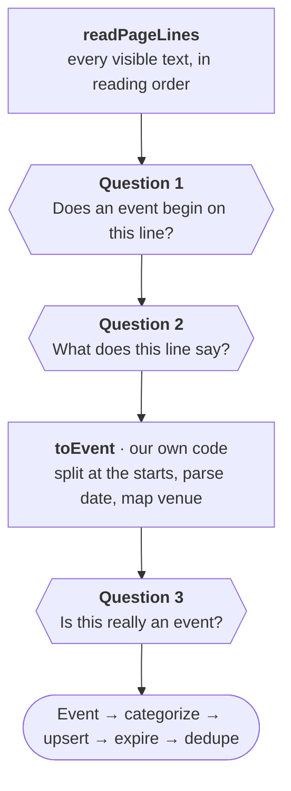

# Puppeteer Collection

The collector reads a source page the way a person reads a printout: top to bottom, one line at a
time. A decision model is asked where each event begins and what each line says, but it never
writes any text — every title, date and venue is copied from the page, so an event can only be
mislabelled, never invented.

## How it works

Three questions, each asked once per source, each with one job. Questions 1 and 2 are about the
same list of lines and share one state, so they go out together.

## Why lines

A page is read as text, not as markup. `readPageLines` walks the **text nodes** of the page, not
its elements: a title written beside a `` belongs to no element of its own, and a walk over
elements loses it entirely. Each text is measured where it is painted, so the lines come back in
reading order even when the stylesheet lays them out in a different order than the markup.

Texts are joined into one line only when they share the same block of the page. A title and the
`` beside it are one line; two cells of a table row stay apart, because a row holds a title
and a date that have to be told from each other.

There is no selector, no section, and no per-source markup knowledge — a source is a URL and a
name. The page is read until the line count stops growing, which is what lets a list that renders
after the network goes quiet still be seen.

## What the model decides, and what it cannot

| | Decided by the model | Decided by our code |
|---|---|---|
| Where an event begins | ✅ question 1 | |
| How many events | | ✅ one per start |
| What a line says | ✅ question 2 | |
| Whether it is really an event | ✅ question 3 | |
| The text of every field | | ✅ copied verbatim |
| Date and time | | ✅ `parseNorwegianDate` |
| Venue name | | ✅ `mapLocation` |
| Event URL | | ✅ the title line's own link |

Lines above the first start are page furniture and are thrown away. A line answered `other`, or
answered below `MIN_CONFIDENCE` (0.6), is ignored. An event with no title or no readable date is
dropped — that is what removes the cinema's `Siste dag *` line. An event scoring below
`MIN_PROBABILITY` (0.5) on question 3 is dropped, which is what rejects a news article.

A page writes the day once above several events, so an event with no date of its own borrows the
day from the nearest event above it that has one.

Where a page writes a field label beside its value, the label is `other` and the value is the
field. The model wobbles on this at the margin, so `toEvent` takes the **last** of an event's
location lines: a page writes "Plassering" before the venue, and the street after the house.

> `toLines` is stringified and sent to the browser, so nothing inside it may name a function — not
> even an arrow in a `const`. The build rewrites named functions with a helper the page does not have.

## Known weakness

An event runs until the next one begins, and the last event on a page has nothing to end it, so
the footer joins it. The cinema takes its venue from the address in the footer rather than from
the page, because that address is the last line of the only event on it.

The same gap lets a news article survive: the municipality's front page yields one event it should
not, since question 3 is asked of a headline that has collected a real date from the lines below.

Both want the same thing — a way for an event to end as well as begin. Trailing lines answered
`other` already fall away; it is the ones that genuinely look like a venue or a date that stay.

## Failure handling

`script.ts` owns the per-source `try`/`catch`, so one source failing costs that source's events and
nothing else. `parseEvents` lets a model failure through rather than returning an empty result,
which keeps "this source broke" distinguishable from "this page lists no events". HTTP 429 and 5xx
are retried by `retryTransientFailures` before that. `script.ts` throws only if *every* Puppeteer
source came back empty, which keeps a broken run from committing an empty events file.
