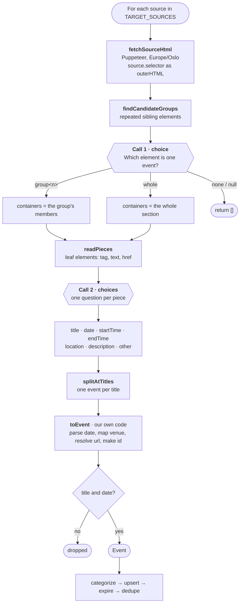

# Puppeteer Collection

The collector reads events straight off each source's own page. A decision model is asked which
elements are events and what each piece of text means, but it never writes any text — every title,
date and venue is copied from the markup, so an event can only be mislabelled, never invented.

## How it works

Two requests per source. The whole page goes out as one `state` object shared by both calls, so the
second is prompt-cached.

## Why the structure decides how many events there are

The model is never asked to count. The number of events is whatever the markup says it is —
`containers.length` for the chosen group, plus one more for each extra title inside a container.
A count question was tried and removed: it could only ever estimate a figure the DOM states exactly,
and the one job it did do, stopping on a page with no events, is already covered by the `none`
answer in call 1 (Brønnøy kommune's news list is rejected at 0.92 confidence).

## What the model decides, and what it cannot

| | Decided by the model | Decided by our code |
|---|---|---|
| Which elements are events | ✅ call 1 | |
| How many events | | ✅ `containers.length` + titles |
| What a piece of text means | ✅ call 2 | |
| The text of every field | | ✅ copied verbatim |
| Date and time | | ✅ `parseNorwegianDate` |
| Venue name | | ✅ `mapLocation` |
| Event URL | | ✅ first same-host link |

A piece whose answer is `other`, or that comes back below `MIN_CONFIDENCE` (0.6), is ignored. An
event with no title or no readable date is dropped — that is what removes the cinema table's
`Siste dag *` row, which has a date but no film.

## Sources and what they look like

| Source | `selector` | Event container | Notes |
|---|---|---|---|
| Brønnøy kino | `.InnholdTabell` | `tr.InnholdTabellTekst` | A table. `outerHTML` matters here: given a bare `<caption><thead><tbody>` fragment, cheerio drops every `<tr>`. |
| Brønnøy kirke | `.calendar` | `div.calendar-item` | One item can hold a whole day, so `splitAtTitles` separates the services and the second borrows the day's date. The time is written *above* its title. |
| Brønnøy bibliotek | `.arena-events-container` | `div.col-md-6.col-sm-12` | JavaScript-rendered. Carries a closing time, so these events get an `endDate`. |
| Brønnøy kommune | `#bottom-boxes` | — | A news list, structurally identical to an event list. Call 1 answers `none`. |

## Failure handling

Every model call sits inside a `try`/`catch` that warns and returns an empty result, so one source
failing costs that source's events and nothing else. HTTP 429 and 5xx are retried by
`retryTransientFailures` before that. `script.ts` throws only if *every* Puppeteer source came back
empty, which keeps a broken run from committing an empty events file.
