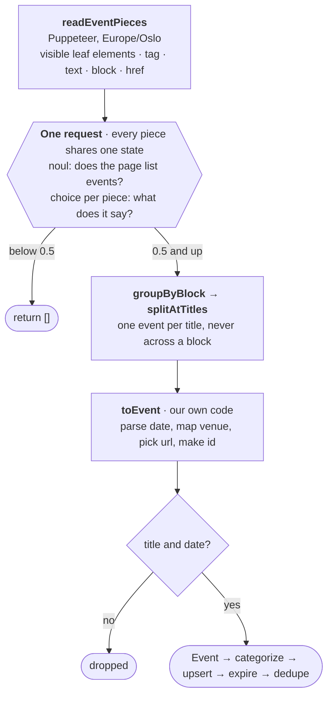

# Puppeteer Collection

The collector reads events straight off each source's own page. A decision model is asked whether
the page lists events and what each piece of text means, but it never writes any text — every title,
date and venue is copied from the markup, so an event can only be mislabelled, never invented.

## How it works

One request per source, answered in under a second.

## Why the markup decides how many events there are

The model is never asked to count. A page states how many events it has by repeating the markup of
one, so `readEventPieces` gives every piece the **outermost ancestor that stands among look-alike
siblings** — the card, row or item holding a single event. Pieces of one block never join another,
and a block holding a whole day is split again at its titles.

Grouping by title alone was tried and failed: when one card carries a piece fewer than its
neighbour, its closing time sits nearer the next card's title and attaches there.

## What the model decides, and what it cannot

| | Decided by the model | Decided by our code |
|---|---|---|
| Whether the page lists events | ✅ `listsEvents` | |
| How many events | | ✅ blocks + titles |
| What a piece of text means | ✅ one choice per piece | |
| The text of every field | | ✅ copied verbatim |
| Date and time | | ✅ `parseNorwegianDate` |
| Venue name | | ✅ `mapLocation` |
| Event URL | | ✅ the title's own link |

A piece whose answer is `other`, or that comes back below `MIN_CONFIDENCE` (0.6), is ignored. An
event with no title or no readable date is dropped — that is what removes the cinema table's
`Siste dag *` row, which has a date but no film. A page scoring below `MIN_EVENT_LIST_PROBABILITY`
(0.5) yields nothing at all, which is what rejects Brønnøy kommune's news list at 0.07.

Where a page writes a field label beside its value, the label is `other` and the value is the field.
The model wobbles on this at the margin, so `toEvent` takes the **last** of an event's location
texts: a page writes "Plassering" before the venue, and the street after the house.

## What the browser does for us

Reading the live DOM rather than its HTML means the browser has already done the work:
`innerText` collapses whitespace, `checkVisibility` hides what a reader cannot see, and an anchor
resolves its own `href` and `origin`, so a link that leaves the site is dropped without parsing a
single URL.

> `toPieces` is stringified and sent to the browser, so nothing inside it may name a function — not
> even an arrow in a `const`. The build rewrites named functions with a helper the page does not have.

## Sources and what they look like

| Source | `selector` | Event block | Notes |
|---|---|---|---|
| Brønnøy kino | `.InnholdTabell` | `tr.InnholdTabellTekst` | A table. The film's own link leaves for filmweb, so the event keeps the cinema page. |
| Brønnøy kirke | `.calendar` | `div.calendar-item` | One item can hold a whole day, so `splitAtTitles` separates the services and the second borrows the day's date. The time is written *above* its title. |
| Brønnøy bibliotek | `.arena-events-container` | `div.col-md-6.col-sm-12` | JavaScript-rendered, and it fills itself in *after* the network goes quiet, so it is the one source carrying a `waitFor`. Has a closing time, so these events get an `endDate`. |
| Brønnøy kommune | `#bottom-boxes` | — | A news list, structurally identical to an event list. `listsEvents` answers 0.07. |

## Failure handling

`script.ts` owns the per-source `try`/`catch`, so one source failing costs that source's events and
nothing else. `parseEvents` lets a model failure through rather than returning an empty result,
which keeps "this source broke" distinguishable from "this page lists no events" in the log. HTTP
429 and 5xx are retried by `retryTransientFailures` before that. A page that never renders is read
as it is rather than throwing. `script.ts` throws only if *every* Puppeteer source came back empty,
which keeps a broken run from committing an empty events file.
